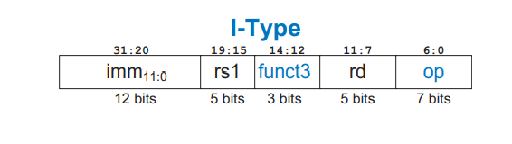
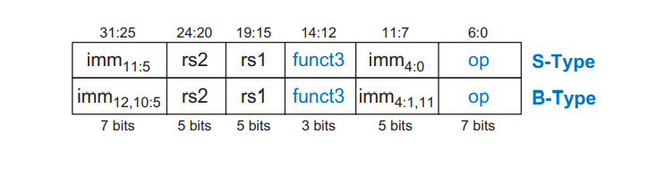
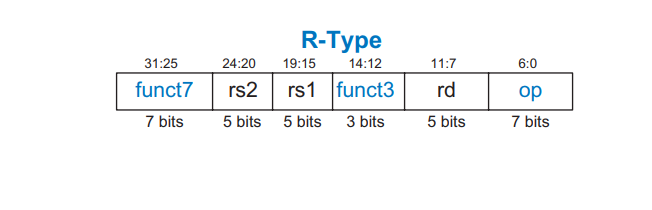
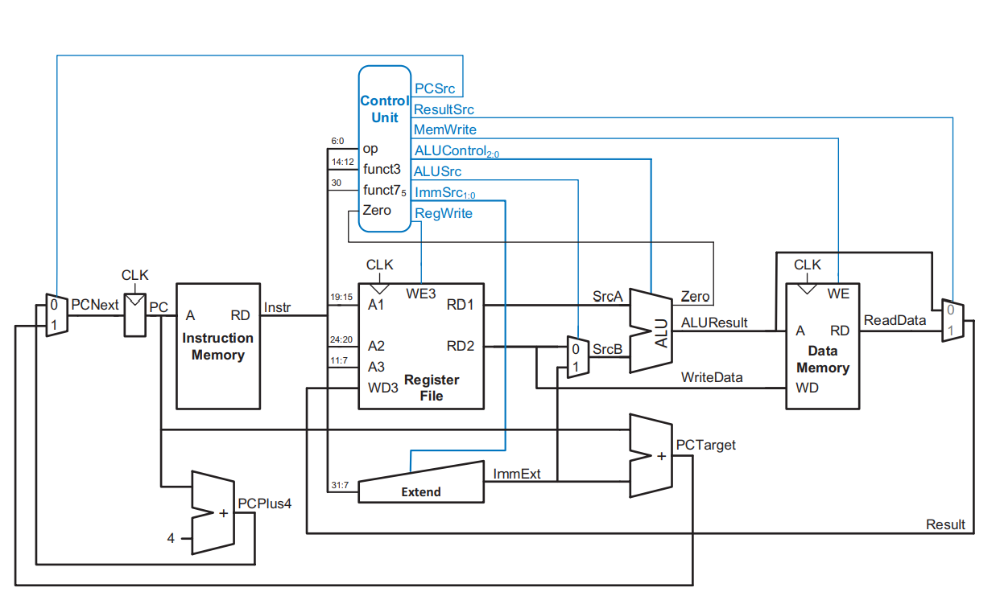
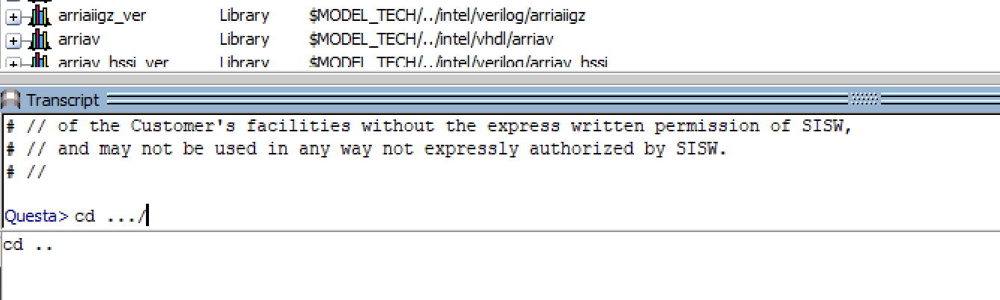
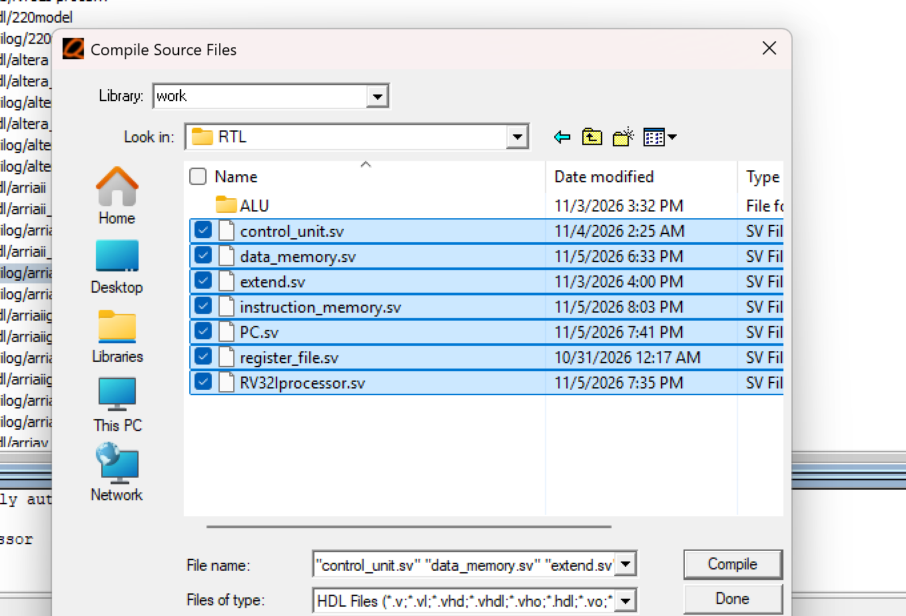
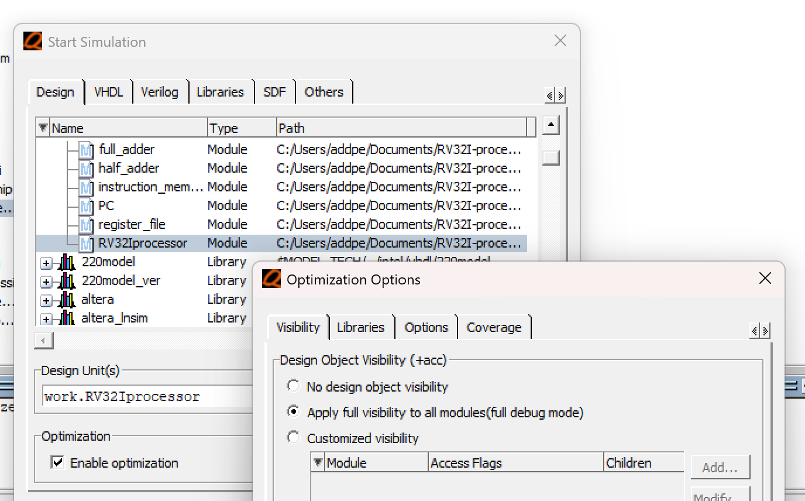

# RV32I Processor

This repository holds the design files for a single cycle processor implementing a subset of [RV32I](https://docs.riscv.org/reference/isa/v20240411/unpriv/rv32.html ) architecture. The microarchitecture was implemented following the specifications in ["Digital Design and Computer Architecture: Risc-V Edition"]( https://pages.hmc.edu/harris/ddca/ddcarv.html ). This design is for hobby and educational purposes. Currently, there's no way to load constants but that will soon change with the implementation of the `addi` instruction.

## Architecture
The processor has 32 regsisters each referred to by a number between 0 and 31. It also takes four instruction types: __I__, __S__, __B__ , and __R__. 

### I-Type Instructions
I-type instructions have three operands. One source register specified by bits 19:15, one destination register from bits 11:7, and one 12 bit constant from 31:20. 

### S/B-Type Instructions
S and B-type instructions both take two source registers and one 12 bit constant. Source one from 19:15 and source two from 24:20. The difference between them lies in how the bits are swizzled into 31:25 and 11:7. 

### R-Type Instructions 
R-type instructions take two source registers and one destination register. Source one and source two are the same as in S/B-type instructions. The destination is stored in bits 11:7.

### All Implemented Instructions

| Instruction | Type | Opcode | funct3 | funct7 | Description |
|:-----------:|:----:|:------:|:------:|:------:|:-----------:|
| `lw` | I | `0000011` | `010` | *none* |The 12 bit constant is added to the base address stored in the source register. The data memory is addressed by the sum and the value stored there is loaded into the destination register. | 
| `sw` | S | `0100011` | `010` | *none* | The memory address is the sum of the base address stored in the source register and the 12 bit constant. `sw` writes the contents of the destination register to that location. | 
| `add` | R | `0110011` | `000` |`0000000` | The sum of the values in the two source registers is stored in the destination register. |
| `sub` | R | `0110011` | `000` | `0100000` |The difference of the values in the two source registers is stored in the destination register. |
|`or` | R | `0110011` | `110` | `0000000` |The bitwise or of the two source registers is stored in the destination register. |
| `and`| R | `0110011` | `111` | `0000000` | The bitwise and of the two source registers is stored in the destination register. |
| `slt` | R | `0110011` | `010` | `0000000` | If the value in source one is less than the value in source two, `1` is written to the destination register. Otherwise `0` is written.|
| `beq` | B | `1100011` | `000`| *none* | `beq` compares the values in the two source registers. If they are equal, the constant is added to the program counter. |

## Microarchitecture

One the rising edge of a clock cycle, the program counter output signal addresses the instruction memory to produce the next instruction to execute. funct3, funct7, and the opcode are fed to the control unit to determine the instruction type and produce control signals accordingly. The register indices proceed to the register file while the constant is sign extended into a 32 bit word. Depending on the instruction, the register values/constants are fed to the ALU whose output addresses the data memory or writes to the register file. In the case of `beq` the sum of the program counter output and constant is fed back into the program counter to load the next instruction. Otherwise, four is added to the output which addresses in instruction memory on the next rising edge. 

## How to Contribute

Install [Quartus Prime](https://www.altera.com/products/software-tools/quartus-prime#download) and click on the `.qpf` to build the project. To simulate, open Questa and change the working directory to the project directory in console. Compile all design files and start the simulation in debug mode. 

